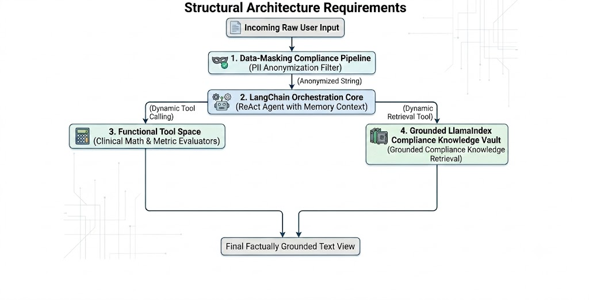

# AfyaPlus Week 2 — Enterprise-Grade RAG-Powered Agent System

> **Educational prototype only.** Manuals are synthetic. No real patient data, real
> insurance verification, medical prescribing, diagnosis, or production compliance claims.



## Architecture

1. **Input privacy layer** (`app/privacy.py`) replaces common Kenyan phone numbers
   and email addresses with per-session placeholders before the agent sees text.
2. **LangChain agent** (`app/agent.py`) selects between the document search tool and
   typed, defensive math tools. The model runs locally using Ollama.
3. **LlamaIndex knowledge vault** (`app/rag_pipeline.py`) reads synthetic Markdown
   manuals, segments by sentences with overlap, embeds locally using Hugging Face,
   and persists vectors in local Chroma. Each retrieved passage includes a filename
   and chunk identifier. Rebuild explicitly after editing manuals.
4. **Memory** keeps the most recent masked human/assistant messages per session.
   The session's private token map is never added to prompts or vector storage.
5. **Output** is masked by default; an authorized integration may explicitly enable
   restoration for a particular session. The CLI never restores identifiers.

## Requirements

- Python 3.11 or 3.12, Git, and a running [Ollama](https://ollama.com/)
- Enough disk space for local embedding and chat model downloads
- Network access on initial setup to download Python packages and models

## Setup (PowerShell / VS Code)

```powershell
python -m venv .venv
.\.venv\Scripts\Activate.ps1
python -m pip install --upgrade pip
pip install -e '.[dev]'
Copy-Item .env.example .env
ollama pull llama3.2:3b
ollama serve
```

Run `ollama serve` in a separate terminal if Ollama is not already running.

```powershell
python -m app.main --index-only
python -m app.main
```

After editing `knowledge_manual/*.md`, rebuild with:

```powershell
python -m app.main --reindex --index-only
```

## Example questions (fictional data only)

- "Does this manual guarantee outpatient coverage?"
- "What is the sample claims verification workflow?"
- "A clinician confirmed 250 mg and the label says 50 mg/mL. What is the volume?"
- "What is BMI for 81 kg and 1.8 m?"
- "My demo email is jane@example.com. What does the policy say about privacy?"

Expected: citations to manual filenames for policy claims, refusal to guarantee
coverage, math tool outputs with validation, and no raw email in model prompts.
LLM behavior may vary. **Review all outputs; do not treat these as medical advice.**

## Tests

```powershell
pytest -q
```

Offline tests use stub agent and fake retrieval nodes; they do not require a
running Ollama or downloading an embedding model. Also run the CLI end-to-end
and capture sample grounded answers before submitting. Automated tests alone
**do not establish** that the agent always retrieves correctly or never hallucinates.

## Token and cost management

- Local Ollama avoids metered cloud API calls but uses local compute resources.
- Limit history to `MAX_HISTORY_MESSAGES` (default 12) to bound context growth.
- Retrieve only `TOP_K` chunks (default 4) instead of passing entire manuals.
- Sentence-based chunks of 512 tokens with 64-token overlap reduce fragmentation.
- Vector storage is persisted locally, avoiding repeated embedding on each run.

## Compliance and safety guardrails

- Default output stays anonymized. De-masking is an explicit, authorized operation.
- Never put the private token map in prompts, embeddings, or logs.
- Never use real patient information in this demo.
- Insurance verification must be performed by authorized human staff.
- Calculation tools do not select doses or provide medical treatment guidance.
- Unsupported policy questions must be answered with uncertainty, not invented facts.
- See [security limitations](docs/SECURITY.md). Regex masking alone does **not**
  establish Kenya Data Protection Act 2019 compliance.

## Git workflow / submission

From an existing Git repository with `main`:

```powershell
git switch main
git pull origin main
git switch -c feat-rag-agent-system
# Copy project files into your repository, then test and review changes.
git add .
git commit -m "feat: add privacy-first RAG agent and validated tools"
git push -u origin feat-rag-agent-system
```

Open a GitHub pull request from `feat-rag-agent-system` into `main`, request a
review, record test evidence in `docs/PR_TEMPLATE.md`, and merge **only after**
review. This ZIP is a project template; it does not contain a real Git history,
remote PR, or completed peer review. Do not claim those steps are complete.

## Known limitations

- RAG uses top-k semantic retrieval; a relevance threshold and stricter
  post-generation citation verifier should be added before any real deployment.
- LLMs can fail to call tools or obey instructions; manually test and evaluate.
- Only common Kenyan phone/email patterns are masked, not all PII.
- Memory is in-process and lost at restart; there is no multi-user authentication.
- Chroma persistence does not auto-refresh when manuals change; use `--reindex`.
- Dependency version ranges are provided; pin exact versions after a successful
  local integration test for reproducible deployment.


## Verification Results

The AfyaPlus Week 2 project was tested
locally using Python 3.12.10.

- Automated tests: 11 passed
- Python compilation: passed
- LangChain knowledge retrieval: demonstrated
- Local Ollama model: tested

The system uses synthetic medical insurance
documents for educational purposes.
